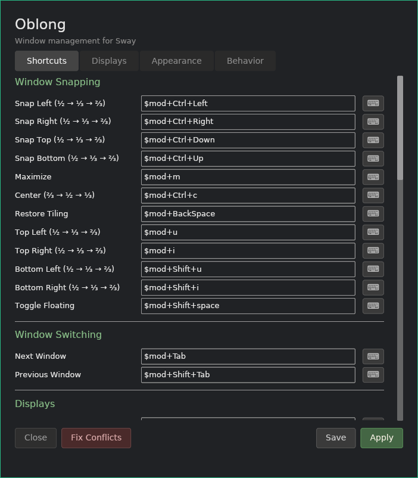
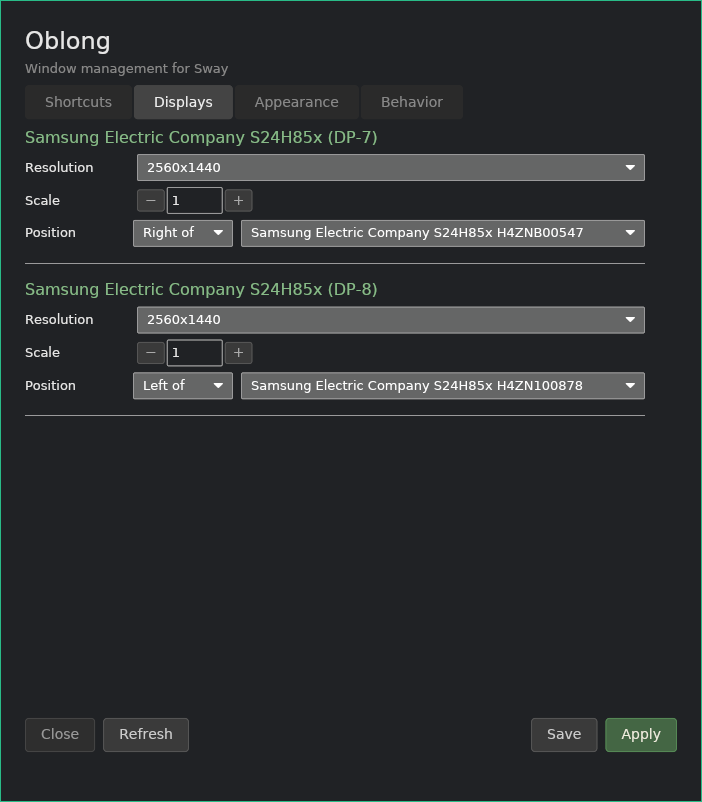
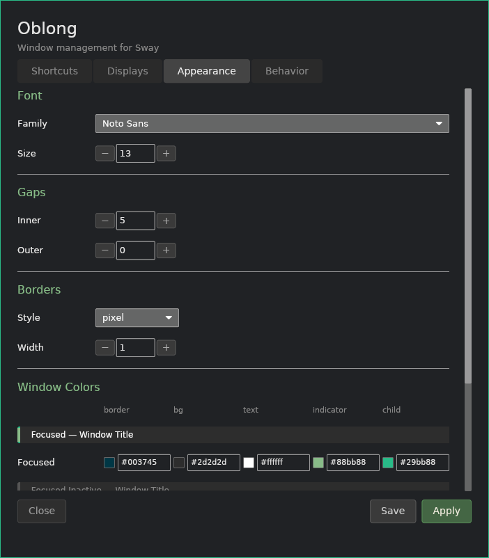
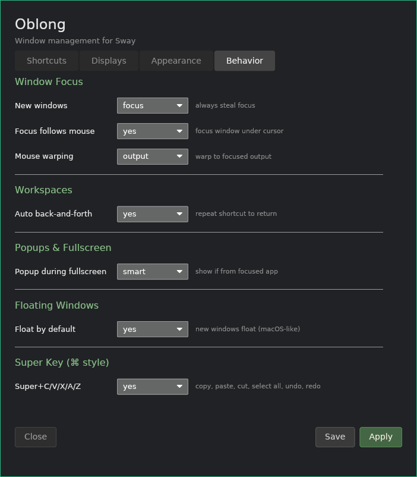

# Oblong

```sh
curl -fsSL https://raw.githubusercontent.com/mvhenten/oblong/main/install.sh | sh
```

Installs the latest build to `~/.local/bin/oblong` and adds an Oblong entry to your app launcher (Linux x86_64).

Window management for Sway with a macOS-like feel. Snap windows with Rectangle's Ctrl+Option chords, switch with Cmd+Tab, keep Cmd for app shortcuts, and configure everything through a GUI.



## Features

- **Window snapping** — halves, thirds, two-thirds, corners, center. Cycles on repeat.
- **MRU window switching** — Cmd+Tab cycles most-recently-used (no daemon needed)
- **macOS-style Cmd key** — Cmd+C/V/X/A/Z, Cmd+T/N/W/L/R/F/Q and Cmd/Option text navigation (via wtype, togglable)
- **Launcher, terminal and screenshots** — Cmd+Space launcher, Cmd+Return terminal, Cmd+Shift+3/4/5 screen/region/window capture (set on the Behavior page)
- **GUI config editor** — four tabs for shortcuts, displays, appearance, and behavior
- **Key recording** — click ⌨ then press a combo to capture it
- **Conflict detection** — warns on duplicate keybindings, can auto-fix

## Default keymap

Cmd is Super ($mod), Option is Alt (Mod1).

| Keys | Action |
|---|---|
| Ctrl+Opt+Left/Right/Up/Down | Snap to left/right/top/bottom half |
| Ctrl+Opt+U/I/J/K | Snap to top-left/top-right/bottom-left/bottom-right |
| Ctrl+Opt+Return / C / Backspace | Maximize / center / restore tiling |
| Ctrl+Opt+Shift+arrows | Focus left/right/up/down |
| Ctrl+Opt+Cmd+arrows | Move window |
| Ctrl+1..9 / Ctrl+Shift+1..9 | Go to / move window to workspace |
| Ctrl+Opt+R / S / W / E / B / V | Resize mode / stacking / tabbed / toggle split / split horizontal / split vertical |
| Ctrl+Cmd+F | Fullscreen |
| Ctrl+Opt+Shift+R / Cmd+Shift+Q | Reload sway / exit sway |
| Cmd+Tab / Cmd+Shift+Tab | Next / previous window |
| Cmd+C/V/X/A/Z, Cmd+Shift+Z | Copy, paste, cut, select all, undo, redo |
| Cmd+T/N/W/L/R/F, Cmd+Shift+T | New tab, new window, close tab, address bar, reload, find, reopen tab |
| Cmd+Q | Close window |
| Cmd+Left/Right, Cmd+Up/Down | Line start/end, document start/end |
| Opt+Left/Right | Word left/right |
| Cmd+Backspace / Opt+Backspace | Delete to line start / delete word |
| Cmd+Space / Cmd+Return | Launcher (`fuzzel`) / terminal (`foot`) |
| Cmd+Shift+3 / 4 / 5 | Screenshot screen / region / focused window to ~/Pictures |

In terminals Cmd+C/V copy and paste and Ctrl+C stays an interrupt. "Fix Conflicts" comments out bindings in your sway config that use these keys or that the keymap moved; "Reset" loads the default keymap.

## Usage

```bash
# Snap the focused window
oblong snap left       # cycles: half → third → two-thirds
oblong snap right
oblong snap up
oblong snap down
oblong snap topleft / topright / bottomleft / bottomright
oblong snap center     # cycles: 60% → 50% → 33%
oblong snap maximize
oblong snap restore    # back to tiling

# Switch windows (MRU order)
oblong switch next     # Cmd+Tab
oblong switch prev     # Cmd+Shift+Tab

# Open the GUI
oblong gui
oblong                 # gui is the default
```

## Install

Use the one-line installer above. To build from source instead, run `cargo build --release` and copy `target/release/oblong` onto your PATH.

### Optional dependencies

- **wtype** — required for the Cmd app shortcuts (`apt install wtype`)
- **grim** + **slurp** — for the Cmd+Shift+3/4/5 screenshot shortcuts
- **swaylock** + **swayidle** — for lock screen

## GUI

| | |
|---|---|
|  |  |
|  |  |

- **Shortcuts** — edit keybindings with live recording, duplicate detection, and conflict resolution
- **Displays** — resolution, scale, and relative positioning for connected monitors
- **Appearance** — font, gaps, borders, and per-class window colors with inline color picker
- **Behavior** — focus policy, floating defaults, macOS-style Cmd key toggle

## File Layout

```
~/.config/oblong/
    bindings.json          # source of truth for shortcuts
    outputs.json           # source of truth for display config
    appearance.json        # source of truth for appearance
    defaults.json          # source of truth for behavior

~/.config/sway/oblong/
    shortcuts.conf         # generated sway bindsyms
    outputs.conf           # generated sway output blocks
    appearance.conf        # generated sway appearance
    defaults.conf          # generated sway behavior defaults
    super-key-helper.sh    # generated script for Super+C/V

~/.config/sway/config
    include ~/.config/sway/oblong/*.conf   # one line added by oblong
```

The JSON files are the source of truth. The `.conf` files are generated — don't edit them by hand.

## Design Decisions

### Never touch the user's config

Oblong is **additive only**. It never modifies `~/.config/sway/config` beyond adding a single `include` line. All managed settings go into `~/.config/sway/oblong/`. Removing the include reverts everything.

### MRU window switching without a daemon

Sway's tree already tracks focus order in each container's `focus` array. The switcher reads this on each invocation and freezes the MRU list for the duration of a rapid Tab cycle (1.5s timeout). No background process needed.

### macOS-style Cmd key

When enabled, `Cmd+C` sends `Ctrl+Shift+C` in terminals (copy) and `Ctrl+C` in GUI apps. Detection is automatic via `swaymsg get_tree`. Requires `wtype`.

### Snap cycling

Repeated snaps cycle: **half → third → two-thirds**. State tracked in `$XDG_RUNTIME_DIR/oblong-state` with 1.5s timeout.

### Keybinding conflicts

Duplicate `bindsym` in sway fires both — it's not last-wins. Oblong detects this and the "Fix Conflicts" button comments out conflicting lines prefixed with `# [oblong]`.
